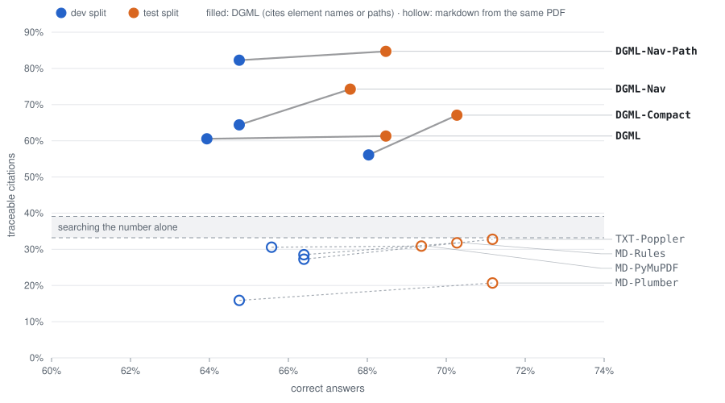
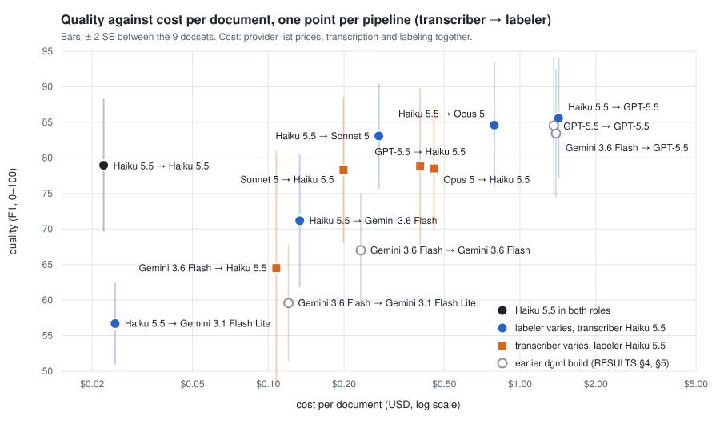

# DGML Compass

2.5× the traceable reasoning of markdown at half the tokens. And Compass picks models that create
DGML up to 30× cheaper than the best-scoring.

Open benchmarks on [dgml](https://github.com/dgml-io/dgml), which turns PDF and DOCX into DGML,
semantic XML whose tags say what things are. Both use public documents only and ship their
reference results, with tests that pin the published numbers, so you can rescore or re-run them.

| Claim | Result | Source |
|---|---|---|
| **2.5× traceable reasoning** | Figures the model reasons from that point to one exact place in the document: 82-85% with DGML against 16-33% with markdown | [reasoning/README.md](reasoning/README.md#the-result) |
| **½ the tokens** | What the model used to answer the same questions: 6.6-7.0 M tokens with DGML against 11-14 M with markdown | [reasoning/README.md](reasoning/README.md#the-result) |
| **Up to 30× cheaper to create DGML** | Model Compass finds the models that turn your documents into DGML: 93.4 F1 at $0.045 per document, against 94.3 F1 at $1.33 | [models/docs/RESULTS.md](models/docs/RESULTS.md#6-cost-and-tokens) §6 |

The two folders are separate projects, each with its own `pyproject.toml`, data, results, tests
and README; run each project's commands from its own folder.

| Folder | Question | Runs over | Needs |
|---|---|---|---|
| [`reasoning/`](reasoning/README.md): **DGML vs markdown: traceable reasoning** | An agent reads a filing as DGML or as markdown converted from the same PDF: does each figure it reasons from point to one exact place in the document? | 30 SEC 10-K filings, 233 DocFinQA questions | nothing to rescore: offline, from the shipped answers |
| [`models/`](models/README.md): **Model Compass: picking your pipeline** | Which models should transcribe and label documents into DGML, by quality, consistency and cost? | 9 public docsets (205 documents with gold DGML and field values) | a dgml checkout and provider keys for new runs; scoring and reports need neither |

## Why: markdown was built for humans

Documents are usually turned into markdown before they are fed to agents. Markdown names the
shape (headings, tables) but not the substance, so an agent can cite only a heading or a string
of text that often appears in many places. In DGML each value is a single named concept, and the
agent cites an element and its path that lead to one place in the document. In finance, legal,
audit and compliance, a figure you can't trace is a figure you can't use. The full case is at
[www.dgml.io/compass.html](https://www.dgml.io/compass.html).

## 1. DGML vs markdown: traceable reasoning (`reasoning/`)

The same agent answers every question once reading DGML and once reading markdown converted
from the same PDFs by four converters, and cites every figure it uses; a script follows each
citation back into the filing. With DGML navigation and path citations, 82-85% of the figures
point to one exact place in the document, against 16-33% with markdown, at the same accuracy
and with 6.6-7.0 M tokens against 11-14 M.



Each segment is one system, from its dev point (blue) to its test point (orange); filled points
are DGML, hollow points markdown from the same PDF. Every number is in
[reasoning/docs/RESULTS.md](reasoning/docs/RESULTS.md).

It is a Python package, `dgml_reasoning`, with the CLI `dgr` (reproduce, renderings, report,
provenance, figure, run); `uv run dgr reproduce` rebuilds every number in its RESULTS.md without a
key.

## 2. Model Compass: picking your pipeline (`models/`)

dgml uses one model to transcribe a document and one to label it, and the right choice can
differ from one kind of document to another. Model Compass ran 7 sweeps of models from OpenAI,
Google and Anthropic through both roles over 9 public docsets, scored the DGML against gold
annotations, and reports quality, draw-to-draw noise, tokens and cost, to find the most
cost-efficient pair for each need:

| Need | Transcriber → labeler | F1 | $/doc |
|---|---|---:|---:|
| Volume | Haiku 5.5 → Haiku 5.5 | 79 | 0.02 |
| Balanced | Haiku 5.5 → Sonnet 5 | 83 | 0.28 |
| Best | Haiku 5.5 → GPT-5.5 | 86 | 1.42 |

Spend on the labeler: Haiku 5.5 transcribes as well as Sonnet 5, Opus 5 and GPT-5.5 (78.3-78.8)
at 1/9 to 1/20 of their cost. On commercial leases, Haiku 5.5 in both roles scores 93.4 F1 at
$0.045 per document, against 94.3 at $1.33 for the best-scoring pipeline: up to 30× cheaper.



Each point is a pipeline averaged over all 9 docsets.\* Blue points climb with cost: the labeler
buys quality, from Haiku 5.5 (79, $0.02 per document) to GPT-5.5 (86, $1.42). Orange points stay
flat: four of the five transcribers give about 78.5, so the cheapest, Haiku 5.5, is enough. The
bars are wide because the 9 docsets differ far more than the models do; points inside each
other's bars are not distinguishable on this corpus. Gray points come from an earlier dgml
build. Every number is in [models/docs/RESULTS.md](models/docs/RESULTS.md) §6.

\* The best model can change with the kind of document. RESULTS.md breaks every sweep down
[by document shape](models/docs/RESULTS.md#by-shape) (forms, contracts and other long prose,
complex layouts, hybrid documents) and by docset. Only long prose has enough docsets for a firm
ranking; each other shape rests on one or two docsets.

It is a Python package, `model_compass`, with the CLI `dgc` (plan, run, score, aggregate,
report, compare; `sweep` for the configured sweeps end to end, `reference` and `figure` for the
committed results). Paid runs are planned and priced first and stop at a budget cap.

- Results on the bundled corpus: [models/docs/RESULTS.md](models/docs/RESULTS.md)
- Sweeps and how to run them: [models/docs/EXPERIMENTS.md](models/docs/EXPERIMENTS.md)
- Metric definitions: [models/docs/METRICS.md](models/docs/METRICS.md); design decisions and
  known defects: [models/docs/DECISIONS.md](models/docs/DECISIONS.md)

## Quick start

Both projects need [uv](https://docs.astral.sh/uv/) and Python 3.12.

```bash
git clone https://github.com/dgml-io/dgml-compass.git && cd dgml-compass

cd reasoning && uv sync && uv run dgr reproduce && cd ..    # DGML vs markdown: `dgr`, offline
cd models && uv sync && uv run dgc --help && cd ..          # Model Compass: the `dgc` command
```

Each project runs its own tests, with no key and no model call:

```bash
cd reasoning && uv run ruff check . && uv run pytest && cd ..
cd models && uv run ruff check . && uv run pytest && cd ..
```

Everything else, paid runs included, goes through each project's own command: `dgr` in
`reasoning/` (`dgr run <experiment> --yes` re-runs a recorded experiment) and `dgc` in
`models/` (`dgc sweep --yes` runs the configured sweeps).

## Layout

```
reasoning/    DGML vs markdown: benchmark code, filings, answers, figures, tests
models/       Model Compass: package, corpus, sweeps, reference results, docs, tests
LICENSE       applies to the whole repository; reasoning/data/ also carries the FinQA licence
```

Contributions are welcome: see [CONTRIBUTING.md](CONTRIBUTING.md) (pull requests need the one-time
DGML CLA).
